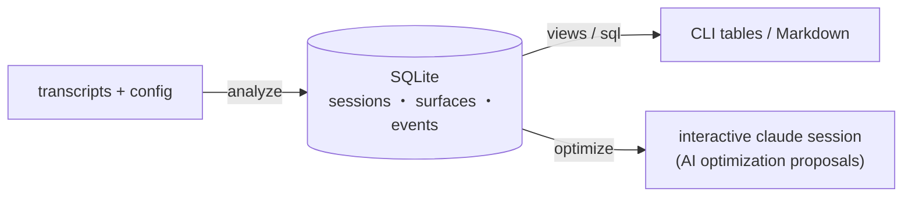
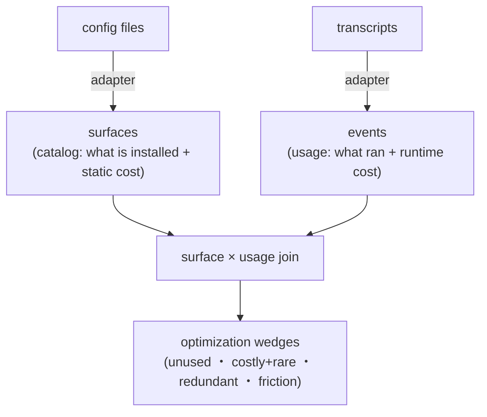
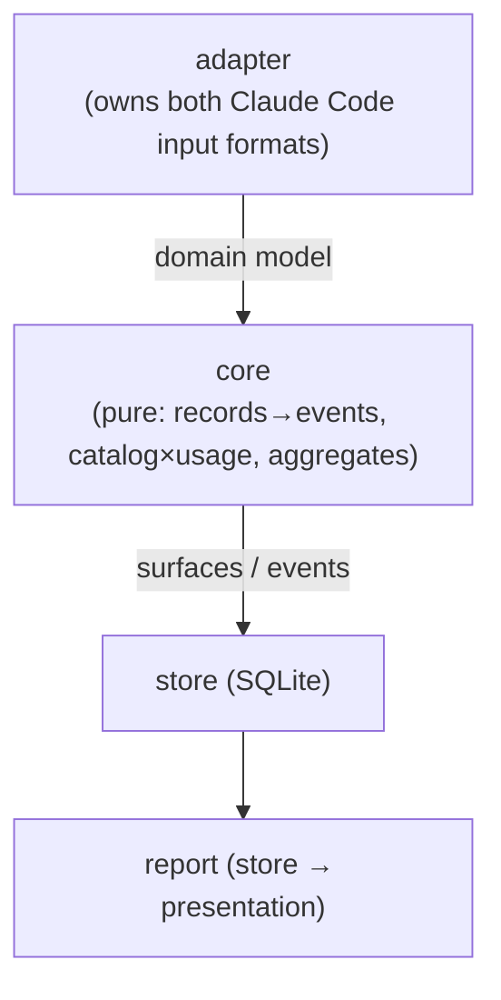

# Architecture Specification

saniwalens answers one question about a coding-agent setup: **where can the
configuration be optimized, and how?** It does that by measuring, from real
usage, the **cost** and **actual use** of every configuration surface ― skills,
rules, hooks, MCP servers and their tool schemas, agents, `CLAUDE.md` /
`AGENTS.md` / memory, permissions ― and surfacing the wedges between the two.

Skills are one surface among many. The tool is configuration-wide. AI-assisted
optimization *proposals* are a planned later layer; the core measures and
visualizes, it does not advise.

The design follows from three facts about the problem:

1. **Two inputs, both upstream-owned.** Cost and use cannot be read from one
   source. *What is installed and what it costs* comes from **live config**
   (skill/rule files, `settings.json`, MCP schemas); *what was actually used and
   at what runtime cost* comes from **session transcripts**. Both formats are
   Claude Code's, and both change between releases.
2. **The answer is a join, not a tally.** Optimization opportunities live in the
   gap between configured and used: installed-but-never-invoked, costly-but-rare,
   redundant. So the model must relate a catalog of surfaces to a log of usage.
3. **Re-parsing is expensive; analysis is iterative.** Hundreds of megabytes are
   read once into a compact store; every report (and the future AI layer) reads
   the store.

## Two stages

- **`analyze`** reads both inputs and writes the normalized store. The verb is
  `analyze` (not `build`): the command *analyzes* raw input into facts, it does
  not build an artifact.
- **The read commands** ― the curated views and the arbitrary-query `sql` ―
  query the store and render. See `cli.md`.

The stages are decoupled *only* by the store. The read commands' **rendering**
never reads raw input; `analyze` never renders. But the stages **compose**: a
view runs the incremental `analyze` stage first by default (`cli.md`
`--frozen`), the way `optimize` always has ― otherwise the store silently goes
stale and the user cannot notice. Composition is stage-before-stage, not a leak:
the view's queries still see only the store. Consumers read the same store. Two
were anticipated, and shape what `analyze` must capture:

- **Optimization proposals** ― turning the findings into concrete advice. This
  is realized by `optimize` (`cli.md`): it composes the headline findings with a
  prescribed advisor prompt and hands them to the harness's advisor session.
  The prompt composition is a pure transform (`core::optimize`); only the process
  launch is I/O. It reads aggregates; it needs nothing the store does not already
  hold.
- **Skill extraction** ― clustering recurring user prompts into candidate new
  skills (the "synthesize a new surface" goal, distinct from pruning existing
  ones). The store keeps only the pointer (`events.prompt` → `(source_path,
  source_line)`; `storage.md`); the `prompts` view re-reads the text at
  report time, masks variable spans (quoted strings, paths, numbers) into a
  reusable template (`core::prompt`), and lists templates repeated at least
  three times as candidates with a count, an exemplar, and their sources.
  Rotated or missing transcripts count as pruned, never as errors. Reworded
  asks that no masking unifies stay unclustered ― that recall limit is
  documented, not papered over. Proposals are presented only, never advised.

## The central model: catalog × usage

- A **surface** is one configurable thing (a skill, a rule, an MCP server, …)
  with a **static cost** ― the token weight of its definition, measured by
  reading the config file. See `surfaces.md` and `config-format.md`.
- An **event** is one timestamped occurrence with a **runtime cost** (tokens,
  context growth, duration). A skill invocation is one event kind among many.
  See `events.md` and `session-format.md`.
- A surface with no matching events is unused; a surface whose static cost is
  high but whose events are few is a prune candidate. The join is the product.

## Layers

Inside `analyze`, knowledge is stratified so an upstream format change lands in
exactly one layer.

| Layer | Owns | Must NOT know |
| --- | --- | --- |
| **adapter** | The raw shapes of *both* inputs: transcript JSONL (record types, field names, `subagents/` layout) and config files (skill/rule frontmatter, `settings.json`, MCP schemas, `CLAUDE.md`). Maps them into the internal domain model. | The SQLite schema; how costs are computed. |
| **core** | Event extraction, static-cost weighing inputs, the catalog×usage join, the trend view's two-window joins (`core::trend`), the briefing's findings assembly (`core::findings`), and aggregation ― all **pure functions** over the domain model; a function that only shapes rows already fetched from the store is core's wherever it is called from today (the placement rule below). No I/O, no clock, no DB. | Claude Code field names or config path conventions; SQL. |
| **store** | Persisting and querying `sessions` / `surfaces` / `events` in SQLite. | Raw input shapes. |
| **report** | Turning query results into tables / Markdown and ranking wedges (`src/cli/`, laid out below). | Raw input shapes; SQL beyond the store's API. |

The report layer is laid out as:

- `cli/mod.rs`: the shell, dispatch and the public CLI API.
- `cli/views/`: one file per view. `cli/views/guide.rs` (the interactive entry),
  `cli/views/trend.rs` (the trend view and the one typed payload both its table
  and JSON derive from), `cli/views/waste.rs`, `cli/views/models.rs` (the
  per-model cost split), and `cli/views/sessions.rs` (the per-session cost
  shape).
- `cli/window.rs`: the windowed flag surface every view shares: the period flags
  declared once as clap arg groups, the `--format` values each view accepts, and
  the windowed session-open dispatch the report arms resolve through (`open` for
  views without `--scope`, `open_scoped` for scoped ones,
  `open_scoped_table_json` for doctor's narrower `--format`, `open_pair` for
  trend).
- `cli/headless.rs`: the headless advisor run (the logged pipe and the one guard
  owning the child and the heartbeat for the run's lifetime).
- `cli/report.rs`: format, renderer, framing.

### The view-landing rule (per PR)

A PR that adds a `Command` variant (a new view) lands the view as one file under
`src/cli/views/`, so views never re-grow a shared file:

- **View helpers are born in the view's file**, never appended to `cli/mod.rs`:
  the shell keeps dispatch and nothing else.
- **The line-budget tripwire** (`tests/cli_mod_line_budget.rs`) makes that
  structural: growing `cli/mod.rs` past its measured budget fails `cargo test`
  with a message pointing at `cli/views/`. Raising the budget is a review point,
  done in the same PR as the spec update it forces.
- **Spec update map.** When the layout changes, two places change with it in the
  same PR: this rule and the report layout list above.

The acceptance-criteria template every view-addition PBI carries is
`.claude/rules/cli-view-addition.md`.

### The pure-join placement rule (per PR)

A pure join (a pairing, ordering, or delta over in-memory values, no SQLite)
over rows already fetched from the store is core's, wherever it is called from
(`.claude/rules/pure-join-placement.md`):

- **Born in core.** A new pure join lands in core with its tests there; the
  store keeps the query and the row hand-off, never the shaping. The one
  integration test pinning the query-to-join window split
  (`two_window_aggregation_splits_events_between_the_windows`) stays in
  `store/mod.rs` with the query it tests.
- **The first instance** is the trend view's two-window joins (`skill_deltas`,
  `TwoWindow`, `SkillDelta`, `TrendWindowAggregates`, `kind_pairs`), which live
  in `src/core/trend.rs`. The store keeps the windowed queries that hand them
  rows. The next SQLite-free function that appears in `store/mod.rs` arms the same
  move.
- **The trigger is grep-able, not a parser.** The rule enumerates the symbols,
  and `tests/pure_join_placement.rs` fails when the enumeration and core drift
  apart: it asserts the definitions sit in `src/core/trend.rs` and not in
  `store/mod.rs`. A join that leaves core or re-enters the store must carry four
  updates in the same PR: the core row above, the rule's enumeration, the
  ledger's note, and the tripwire's move side. Emptying the tripwire's array or
  leaving a tombstone comment does not count, since an empty array passes
  vacuously and a raw `contains` reads comments as text. Retiring the tripwire
  means rewriting the two prose anchors that name it (the rule and this
  section) in the same PR.

The contract between adapter and everything else is the **internal domain
model** ― tool-centric names stable across Claude Code releases. Renaming an
upstream field or moving a config file changes the adapter's mapping, nothing
downstream. This boundary is enforced by `.claude/rules/format-isolation.md`; a
format change whose diff escapes the adapter is a boundary bug.

The per-harness routine that walks this pipeline sits behind one seam:
`Harness::analyze` (`adapter::harness`) dispatches to each harness's own module
― `adapter::claude`, `adapter::opencode`, `adapter::kilocode` ― which owns that
harness's input route, fingerprinting, and extraction wiring, and hands rows to
`Store::ingest` (the store's API, never SQL). The analyzer-version key each
harness stamps lives beside its mapping, and the store compares whatever pair it
is handed. A new harness therefore adds a variant and a module; the shell does
not change (`harness.md`).

### Why a pure core

The tool's value is its analysis logic ― event boundaries, the compaction-safe
context metric, subagent attribution, the catalog×usage join. That logic is
where bugs hide and where the specs make the most claims, so it must be
exhaustively unit-testable. Keeping it free of I/O, clocks, and SQL lets every
rule be driven by a small synthetic fixture (`.claude/rules/tdd.md`). File
walking, reading, tokenizing, SQLite, and "now" are thin shells; non-determinism
(current time, timezone, tuning constants) is injected.

## Forward compatibility

The adapter deserializes defensively: it reads only the fields the tool needs,
ignores unknown fields, tolerates missing optional ones. A new Claude Code field
or config key must never break `analyze`. The concrete shapes the adapter
depends on ― and which are most likely to drift ― are catalogued in
`session-format.md` (transcripts) and `config-format.md` (config).

## What this tool deliberately is not

- **Not a live monitor.** It analyzes inputs at rest, not a running session.
- **Not a billing tool.** Token counts rank surfaces; they are not an accounting
  ledger. Approximations (estimated subagent attribution, tokenizer-based static
  cost) are acceptable and flagged, not avoided.
- **Not an advisor (yet).** The core reports opportunities; turning them into
  concrete proposals is the future AI layer's job.
- **Not a data store.** Raw transcripts and config stay where Claude Code put
  them; the tool reads them read-only and never copies them into the repo or the
  store (`.claude/rules/session-data-privacy.md`).
